  

  
  

### Hi, I'm Joshua 👋

I'm a software engineer at **Markel** by day. The rest of the time I build things that leave the screen: sensors on food pantry doors, an NFC tag that logs my dogs' medication in one tap, a monitor that tells my Arch box what is wrong with it before I find out the hard way.

I like software that has a physical consequence, runs on hardware I can hold, and still works when the network does not.

## 🔭 What I'm building

<table>
<tr>
<td width="50%" valign="top">

### 🧵 [jstack](https://github.com/JoshuaHayesWasHere/jstack)

My agent stack for Claude Code and T3 Code. Each task is one agent thread in its own worktree: a home plans it and writes the brief, a crewmate does the work and opens the pull request, a reviewer checks it, and a bus merges it. What lasts lives on disk, so any thread can end and the next picks up from there.

`Python` `uv` `Claude Code` `T3 Code` `gh`

**[JoshuaHayesWasHere/jstack →](https://github.com/JoshuaHayesWasHere/jstack)**

</td>
<td width="50%" valign="top">

### 🥫 Little Ram Pantries

Free food pantries across VCU's campuses, each with a door sensor and a camera, so a student can check what is on the shelf before making the walk.

I lead the engineering: the public site (map, a page per pantry, works offline), the admin tools for restocking and outages, the device fleet, and the AWS accounts underneath.

`TypeScript` `Go` `AWS IoT Greengrass` `CloudFront`

**[littlerampantries.com →](https://littlerampantries.com/)**

</td>
</tr>
<tr>
<td width="50%" valign="top">

### 🩺 Archaholics Anonymous

`aa check`: a read-only health monitor for Arch Linux. It probes the system, ranks what it finds by severity, and hands you the exact command to fix each problem. It never changes anything itself.

`Python` `uv` `systemd` `pacman`

</td>
<td width="50%" valign="top">

### 🐕 Winnifred

A medication tracker for the dogs in my household. Each dose schedule lives on the server, which works out what is due today, and tapping an NFC tag logs a dose.

`Go` `TypeScript` `Svelte` `DynamoDB` `NFC`

</td>
</tr>
</table>

> ### 🖥️ My setup: [dotfiles](https://github.com/JoshuaHayesWasHere/dotfiles)
>
> Everything on the machine the projects above get built on: Arch and Hyprland, a zsh setup split so coding agents get a fast, plain shell while I keep the fancy one, kitty, tmux, Neovim, and my full Claude Code configuration.
>
> `Arch Linux` `Hyprland` `zsh` `tmux` `Neovim` `Claude Code`

## 🐍 A year of commits, eaten

  <picture>
    <source media="(prefers-color-scheme: dark)" srcset="https://raw.githubusercontent.com/JoshuaHayesWasHere/JoshuaHayesWasHere/output/snake-dark.svg">
    
  </picture>

## 🧰 Toolbox

  
   
  

## 🧭 How I work

- **Ship the whole thing.** Frontend, API, infrastructure, the device on the wall, and the release notes.
- **Read-only first.** Tools should explain and recommend before they are ever allowed to change state.
- **Local by default.** One command brings up the full stack with no cloud account.
- **Agents are teammates.** Most of my recent work is built alongside coding agents, with pipelines that check their output before it lands.

  Want to talk pantries, agents, or Arch? <a href="https://www.linkedin.com/in/joshua-hayes-vcu/">Find me on LinkedIn.</a>

